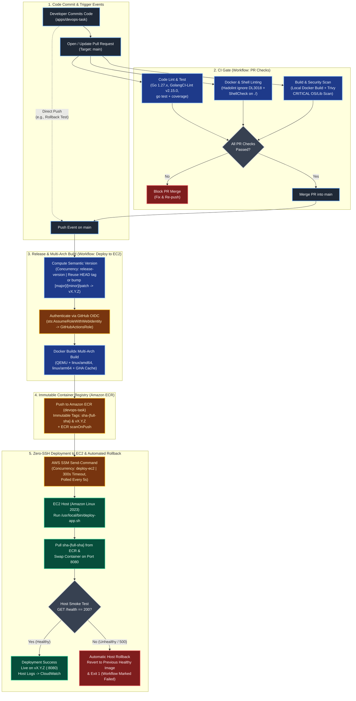
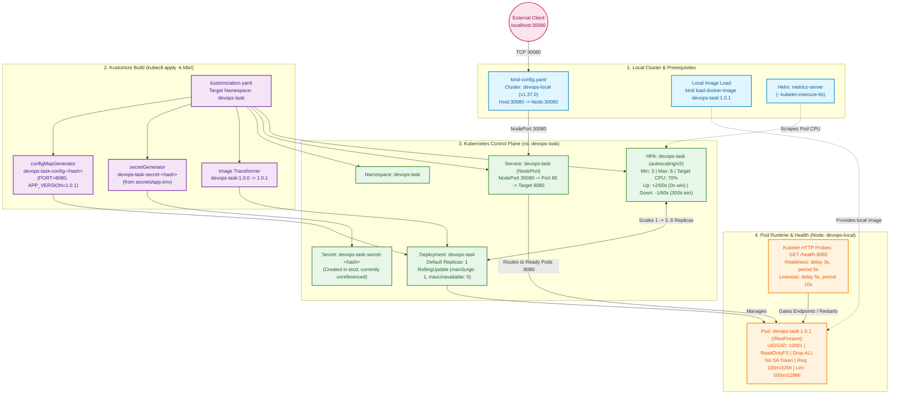
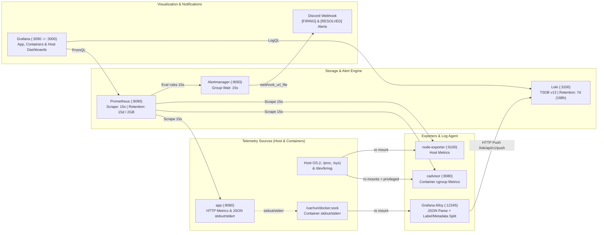

# DevOps Engineer Technical Assessment — `<APP_NAME>`

An end-to-end containerized web service built, tested, scanned, provisioned on AWS via Terraform, deployed to EC2 and Kubernetes, and monitored with a full Prometheus, Loki, Grafana Alloy, Node Exporter, and cAdvisor observability stack.

---

## Table of Contents

// TODO: generate it

---

## 1. Project Structure & Prerequisites

### 1.1 Project Structure

```text
├── .github/
│   └── workflows/                 # CI (PR lint/test/scan) & CD (ECR push + EC2 deploy)
├── apps/
│   └── devops-task/               # Web service source code, unit tests & multi-stage Dockerfile
├── docker-compose.yml             # Local app runtime (port 8080, healthcheck, resource limits)
├── docker-compose.monitoring.yml  # Local observability stack (Prometheus, Grafana, Loki, Alloy, Node Exporter, cAdvisor, Alert-manager)
├── k8s/                           # Kubernetes manifests & Kustomize overlays
├── monitoring/                    # Prometheus, Loki, Grafana Alloy & Grafana provisioned dashboards/datasources
├── reports/                       # Execution logs, test/plan outputs & screenshots for each step
├── scripts/
│   ├── dev_k8s/                   # Local kind cluster bootstrap & Kubernetes test scripts
│   └── system_health_check/       # Linux server health check script (system_health.sh) & timer unit
└── terraform/                     # AWS VPC/EC2/ECR/IAM/CloudWatch IaC with S3 remote state
```

### 1.2 Prerequisites

Install the following tools before running the application, infrastructure, or test scripts:

* **Required:** `docker` (with Docker Compose v2), `awscli`, `terraform`, `kind`, `kubectl`, `shellcheck`
* **Optional:** `gh` (GitHub CLI), `gh nektos plugin`, `hadolint` (Docker lint)

> **Environment Note:** All scripts, Docker Compose stacks, and deployment workflows were developed and verified on **Ubuntu 24.04 LTS** on a remote Linux server. Docker networking, cAdvisor/Node Exporter `/proc` and `/sys` mounts, and file permissions may behave differently on **macOS** or **Windows**.

### 1.3 Application Endpoints & Image Footprint

Go application. 

Entrypoint & Port: server listening on 8080/tcp

* **Endpoints:**
  * `GET /` — Returns `{"message": "Hello from DevOps Task!", "status": "running", "version": "<APP_VERSION>"}`
  * `GET /health` — Liveness and readiness health probe
  * `GET /metrics` — Prometheus-format metrics (request counter, error counter, request duration histogram)
* **Container Image:** Running as a non-root user (`appuser:appgroup`).
* **Final Image Size:** **`Disk usage: 28.7 MB, Acutal Image size / Content size: 7.92 MB`** (verified via `docker images` and `docker image inspect devops-task:1.0.` ).

golang:1.27.3-alpine as builder,
and alpine:3.21
with multi-stage, cross compilation for x86 and arm64. 

### 1.4 ENV Setup and Running the App & Observability Stack

#### Environment Variables

* **Application environment variables** (configured inside `docker-compose.yml`):
  ```env
  PORT=
  LOG_LEVEL=
  ENV_NAME=
  APP_VERSION=
  ```

* **Observability environment variables** (loaded from `.env` file):
  ```env
  GF_SECURITY_ADMIN_USER=
  GF_SECURITY_ADMIN_PASSWORD=
  DISCORD_WEBHOOK_URL=
  ```

#### Running Locally

* **Running the app only** (runs on port `8080`):
  ```bash
  docker compose up
  ```

* **Running the app along with the observability stack**:
  ```bash
  docker compose -f docker-compose.yml -f docker-compose.monitoring.yml up
  ```

With the current configuration:
* **Application** runs on **`http://localhost:8080`**
* **Grafana** runs on **`http://localhost:3090`** (datasources and dashboards are provisioned automatically from `./monitoring/`)

 
## 2. Tests, health script, Terraform code, Kubernetes

### 2.1
for testing go app
cd apps/devops-task
and run go test -v -race -count 10 ./...

### 2.2
Run checks, lints, tests using gh action locally using nektos (also install )
gh act -W .github/workflows/1-pr.yml 

### 2.3 health script


exact steps and screenshots can be at reports/5-LINUX-SCRIPTING.md

### 2.3 Terraform, aws deployment

Ensure aws is configued and logged in. 

exact steps and screenshots can be at reports/2-DEPLOYMENT_TERRAFORM.md

### 2.4 Kubernetes

exact steps and screenshots can be at reports/3-DEPLOYMENT-k8s.md


### 2.5 Obsersvability, Alerts, Monitoring

exact steps and screenshots can be at reports/4-OBSERVABILITY.md


## 3. Architecture Overview

An architecture diagram covering Code Commit → CI (lint, test, scan) → Registry → Deployment
to EC2, along with the Kubernetes deployment flow and the observability stack (how metrics
and logs flow from the app and host into Grafana).


### 3.1 Architecture Diagram for Code to EC2



### 3.2 Architecture Diagram for k8s



### 3.3 Architecture Diagram for Observablity stack




## 4. Design Decisions
 section explaining key trade-offs (e.g. distroless vs Alpine, EC2 vs ECS vs
EKS, your tagging and secrets strategy, log label choices).


# 8. A What I would improve with more time

With more time, 
i would improve it by going through a checklist of testing and chaos engineering to 
push it's limit, calculate ~exact numbers of rps, limits, errors spikes and thorttling it on different percentile to get more detailed scenaiors how it will work under pressure and high load. 
Load balancing for different layers and similar...


1. Better documentation
2. Loading all envs from .env file instead of mixed env file and docker-compose.yml's env


# 9. A short note on whether and how you used AI tools during this task. Using them is allowed; we
only ask that you can explain every part of your submission.

Most of the code parts are generated using with deliberate instructions with task context. And, each part is hand checked, and reports generated are inside ./reports/ with codes for steps producing each. 
