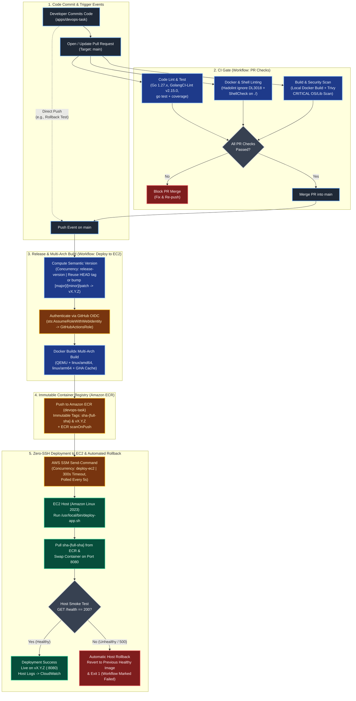
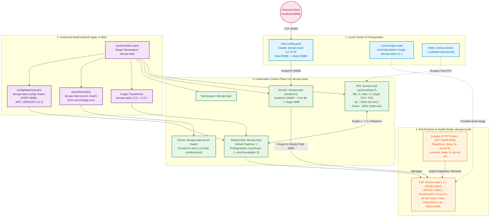
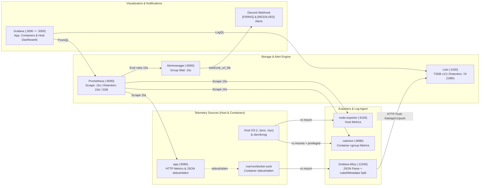

# DevOps Engineer Technical Assessment — `<APP_NAME>`

An end-to-end containerized web service built, tested, scanned, provisioned on AWS via Terraform, deployed to EC2 and Kubernetes, and monitored with a full Prometheus, Loki, Grafana Alloy, Node Exporter, and cAdvisor observability stack.

---

## Table of Contents

// TODO: generate it

---

## 1. Project Structure & Prerequisites

### 1.1 Project Structure

```text
├── .github/
│   └── workflows/                 # CI (PR lint/test/scan) & CD (ECR push + EC2 deploy)
├── apps/
│   └── devops-task/               # Web service source code, unit tests & multi-stage Dockerfile
├── docker-compose.yml             # Local app runtime (port 8080, healthcheck, resource limits)
├── docker-compose.monitoring.yml  # Local observability stack (Prometheus, Grafana, Loki, Alloy, Node Exporter, cAdvisor, Alert-manager)
├── k8s/                           # Kubernetes manifests & Kustomize overlays
├── monitoring/                    # Prometheus, Loki, Grafana Alloy & Grafana provisioned dashboards/datasources
├── reports/                       # Execution logs, test/plan outputs & screenshots for each step
├── scripts/
│   ├── dev_k8s/                   # Local kind cluster bootstrap & Kubernetes test scripts
│   └── system_health_check/       # Linux server health check script (system_health.sh) & timer unit
└── terraform/                     # AWS VPC/EC2/ECR/IAM/CloudWatch IaC with S3 remote state
```

### 1.2 Prerequisites

Install the following tools before running the application, infrastructure, or test scripts:

* **Required:** `docker` (with Docker Compose v2), `awscli`, `terraform`, `kind`, `kubectl`, `shellcheck`
* **Optional:** `gh` (GitHub CLI), `gh nektos plugin`, `hadolint` (Docker lint)

> **Environment Note:** All scripts, Docker Compose stacks, and deployment workflows were developed and verified on **Ubuntu 24.04 LTS** on a remote Linux server. Docker networking, cAdvisor/Node Exporter `/proc` and `/sys` mounts, and file permissions may behave differently on **macOS** or **Windows**.

### 1.3 Application Endpoints & Image Footprint

Go application. 

Entrypoint & Port: server listening on 8080/tcp

* **Endpoints:**
  * `GET /` — Returns `{"message": "Hello from DevOps Task!", "status": "running", "version": "<APP_VERSION>"}`
  * `GET /health` — Liveness and readiness health probe
  * `GET /metrics` — Prometheus-format metrics (request counter, error counter, request duration histogram)
* **Container Image:** Running as a non-root user (`appuser:appgroup`).
* **Final Image Size:** **`Disk usage: 28.7 MB, Acutal Image size / Content size: 7.92 MB`** (verified via `docker images` and `docker image inspect devops-task:1.0.` ).

golang:1.27.3-alpine as builder,
and alpine:3.21
with multi-stage, cross compilation for x86 and arm64. 

### 1.4 ENV Setup and Running the App & Observability Stack

#### Environment Variables

* **Application environment variables** (configured inside `docker-compose.yml`):
  ```env
  PORT=
  LOG_LEVEL=
  ENV_NAME=
  APP_VERSION=
  ```

* **Observability environment variables** (loaded from `.env` file):
  ```env
  GF_SECURITY_ADMIN_USER=
  GF_SECURITY_ADMIN_PASSWORD=
  DISCORD_WEBHOOK_URL=
  ```

#### Running Locally

* **Running the app only** (runs on port `8080`):
  ```bash
  docker compose up
  ```

* **Running the app along with the observability stack**:
  ```bash
  docker compose -f docker-compose.yml -f docker-compose.monitoring.yml up
  ```

With the current configuration:
* **Application** runs on **`http://localhost:8080`**
* **Grafana** runs on **`http://localhost:3090`** (datasources and dashboards are provisioned automatically from `./monitoring/`)

 
## 2. Tests, health script, Terraform code, Kubernetes

### 2.1
for testing go app
cd apps/devops-task
and run go test -v -race -count 10 ./...

### 2.2
Run checks, lints, tests using gh action locally using nektos (also install )
gh act -W .github/workflows/1-pr.yml 

### 2.3 health script


exact steps and screenshots can be at reports/5-LINUX-SCRIPTING.md

### 2.3 Terraform, aws deployment

Ensure aws is configued and logged in. 

exact steps and screenshots can be at reports/2-DEPLOYMENT_TERRAFORM.md

### 2.4 Kubernetes

exact steps and screenshots can be at reports/3-DEPLOYMENT-k8s.md


### 2.5 Obsersvability, Alerts, Monitoring

exact steps and screenshots can be at reports/4-OBSERVABILITY.md


## 3. Architecture Overview

An architecture diagram covering Code Commit → CI (lint, test, scan) → Registry → Deployment
to EC2, along with the Kubernetes deployment flow and the observability stack (how metrics
and logs flow from the app and host into Grafana).


### 3.1 Architecture Diagram for Code to EC2



### 3.2 Architecture Diagram for k8s



### 3.3 Architecture Diagram for Observablity stack




## 4. Design Decisions

## Design Decisions

* **Alpine Base Image (`alpine:3.21` over Distroless):** Built with `golang:1.27.3-alpine` and packaged onto `alpine:3.21` (see `Dockerfile`). Prioritizes a minimal attack surface while retaining shell access and standard debugging utilities for live troubleshooting.
* **EC2 Deployment via AWS SSM (over ECS/EKS):** Production releases run through GitHub Actions OIDC authentication, push multi-arch images to Amazon ECR, and trigger rollouts on EC2 instances via AWS Systems Manager (`send-command`) in `2-deploy.yml`, eliminating bastion hosts and open SSH ports.
* **Local-First Kubernetes Manifests:** Kustomize configurations (`kustomization.yaml`, `deployment.yaml`) are structured for local cluster validation (e.g., `kind`) rather than an automated EKS production pipeline.
* **Immutable Image Tagging:** Every build in `2-deploy.yml` is tagged with both its Git commit SHA (`sha-...`) and semantic version (`vX.Y.Z`) to guarantee deterministic rollbacks and deployment traceability.
* **Zero-Secret CI & Decoupled Configuration:** CI authenticates to AWS via short-lived OIDC tokens rather than static IAM keys. Runtime configuration is separated into Kustomize ConfigMaps (`kustomization.yaml`) and externalized environment secrets (`app.env.example`).
* **Structured JSON Logging for Loki:** Application logs are emitted in structured JSON (`main.go`) and parsed by Grafana Alloy (`config.alloy`) to extract low-cardinality labels for efficient Grafana/Loki querying.


 
## 5. Deployment & Rollback Strategy

### Pre-Merge Checks & Artifact Build
* **Pull Request Validation:** Pull requests targeting `main` run Go linting and tests, Docker and shell linting, and a Docker build with a Trivy scan for critical vulnerabilities. Branch protection must be configured if these checks are to be required before merging.
* **Release Packaging:** A push to `main` triggers the EC2 release workflow, which assigns a semantic version, builds a multi-architecture image, and pushes version and commit-SHA tags to Amazon ECR.
* **Registry Controls:** ECR tag immutability and scan-on-push are evidenced by the setup commands and output in the deployment report, rather than configured in Terraform.

### Production Deployment Execution
* **EC2 Delivery (Current Production Path):** GitHub Actions authenticates to AWS through OIDC and deploys through SSM without SSH. Deployments are serialized to avoid overlapping releases. On EC2, the deploy script starts the new container, replaces the running container on the same host and port, and retries `GET /health`. It records the new image as current only after the health check succeeds. Because the container is replaced in place on the same host and port, this is not a zero-downtime strategy.
* **Kubernetes Rollout (Local Reference):** Kubernetes production deployment to EKS is not currently automated; the documented Kubernetes workflow runs locally on `kind`. Within that local rollout, `maxSurge: 1`, `maxUnavailable: 0`, health probes, and up to five retained revisions support rollout safety.

### Rollback Strategy & Constraints
* **Automated Failure Recovery (EC2):** EC2 rollback is automatic only when the new deployment's `GET /health` check fails. On failure, the deploy script attempts to restore the previous image and marks the workflow as failed.
  * *Limitations:* If the first deployment fails, there is no previous image to restore. If an automatic rollback also fails, manual intervention is required.
* **Planned / Manual Rollback (EC2):** A planned rollback does not have a dedicated workflow. Instead, operators can deliberately redeploy a previously published image by invoking the deploy script through SSM with an earlier immutable tag (such as its commit-SHA tag).
* **Kubernetes Rollback (Local):** Within the documented `kind` environment, rollback is demonstrated via:
  ```bash
  kubectl rollout undo deployment/devops-task -n devops-task


## 6. Security Considerations

- Secrets management:
  - The project already follows a strong baseline by separating configuration from secrets: Kubernetes uses ConfigMaps for non-sensitive runtime values and a secret generator for environment-based secrets, while the CI/CD pipeline authenticates to AWS through short-lived OIDC instead of static long-lived keys.
  - This is good practice because it minimizes secret sprawl and reduces the blast radius of leaked credentials.
  - The weak point is that the repository still relies on local environment files and a secret source pattern that should be replaced in production with a proper secret manager such as AWS Secrets Manager, SSM Parameter Store, or a Kubernetes secret-management workflow.
  - In other words, the design is directionally correct, but production secret lifecycle, rotation, and access control need to be enforced outside the repo.
- Image scanning:
  - The PR workflow includes a Trivy scan on the built Docker image and fails the check on CRITICAL vulnerabilities, which is a meaningful security control.
  - This is a strong safeguard against shipping known vulnerable base images or libraries into the application.
  - The project also describes ECR scan-on-push and immutable image tags, which is a sound operational security pattern for traceability and rollback control.
  - The remaining improvement is to make scans part of a continuous registry policy, not just a PR gate, so newly introduced vulnerabilities are caught later in the lifecycle too.
- IAM and access control:
  - The EC2 instance role is scoped more tightly than a broad admin role: it can pull ECR images, write CloudWatch logs, and use the SSM managed policy for remote management.
  - That is a good least-privilege model and clearly better than granting full administrative access to the host.
  - GitHub Actions also uses OIDC to assume AWS roles instead of embedding static AWS credentials in workflow secrets, which is a mature and safer approach.
  - The main hardening step still needed is to review every future permission added to the deployment pipeline and keep it minimal to the exact AWS actions required.
- Network exposure:
  - The EC2 security group is intentionally restrictive in one sense: it does not expose SSH and only opens the app port, which is a better posture than a default public-SSH setup.
  - However, the Terraform default for allowed CIDRs is 0.0.0.0/0, which means the app is effectively internet-exposed unless that value is tightened in the deployment environment.
  - This is the biggest operational risk in the current design because an application port on a public EC2 instance is much more exposed than a private-only or load-balanced architecture.
  - The Kubernetes setup also uses a NodePort-style pattern for local validation, which is fine for a lab or demo, but not a hardened production exposure model.
- Overall assessment:
  - The project demonstrates a reasonable security baseline for a hands-on DevOps assessment: image scanning, short-lived AWS auth, no SSH exposure, and least-privilege EC2 access.
  - The main gaps are real-world hardening: restrict ingress to trusted networks or put the app behind a managed entry point, move secrets out of local files into a managed secret system, and enforce stronger production network and registry policies. 

## 7. AWS Cost Calculations

### 7.1 Baseline: EC2 Only (Current Terraform `prod.tfvars`)

Running the current Terraform configuration (`us-east-2`, without Kubernetes or the observability stack) costs roughly **$12.10 – $13.40/month** on-demand (or **~$8.45 – $9.75/month** if within the 12-month Free Tier for the single attached Public IPv4):

| Resource | Config (`us-east-2`) | Est. Monthly Cost |
| --- | --- | --- |
| **EC2 (`t3.micro`)** | 1x 24/7 ($0.0104/hr × 730 hrs) | **$7.59** |
| **Public IPv4** | 1x attached ($0.005/hr × 730 hrs) | **$3.65** *(Free in 1st yr)* |
| **EBS (`gp3`)** | 8 GB encrypted root volume ($0.08/GB-mo) | **$0.64** |
| **CloudWatch Logs** | `/devops-task/prod`, 30-day retention (~0.2–2 GB) | **$0.10 – $1.00** |
| **ECR & S3 State** | Multi-arch image storage + `.tfstate` | **$0.10 – $0.50** |
| **SSM, IAM, Egress** | Under 100 GB/mo free internet egress | **$0.00** |
| **Total (EC2 Baseline)** | | **~$12.10 – $13.40 / mo** |

**Single-node adjustments:**
- Upgrading to **`t3.small`** (2 GiB RAM, per `prod.tfvars`) adds **+$7.59/mo** (~**$20/mo** total).
- Switching to **`t4g.small` (`arm64`)** saves ~20% on compute over `t3.small` (~**$17/mo** total).
- Adding an **ALB** for HTTPS/TLS termination adds **~$16.43/mo** base + LCU usage.

---

### 7.2 With Kubernetes (Amazon EKS) & Full Observability Stack

Deploying the `k8s/` manifests (HPA scaling `3–6` app replicas + `metrics-server`) alongside the self-hosted `monitoring/` stack (Prometheus, Loki, Grafana, Grafana Alloy, Node Exporter, cAdvisor, and Alertmanager) requires upgrading from a `1 GiB` `t3.micro` to a multi-node cluster or a larger host:

| Resource | Config (`us-east-2`) | Est. Monthly Cost |
| --- | --- | --- |
| **EKS Control Plane** | 1x cluster, standard support ($0.10/hr × 730 hrs) | **$73.00** |
| **Worker Nodes (`2x t3.medium`)** | 2x nodes (2 vCPU, 4 GiB RAM each @ $0.0416/hr) | **$60.74** |
| **EBS Storage (`gp3`)** | 60 GB total (2× 20 GB node roots + 20 GB Prometheus/Loki PVCs) | **$4.80** |
| **Application Load Balancer** | 1x ALB replacing NodePort `30080` ($0.0225/hr + ~1 LCU) | **$16.43 – $22.27** |
| **NAT Gateway (1x AZ)** | Private-subnet node egress ($0.045/hr + data processing) | **$32.85 – $35.00** |
| **ECR, Logs & S3 State** | Multi-arch images, cluster logs & `.tfstate` | **$1.00 – $3.00** |
| **Total (EKS + Observability)** | | **~$189 – $199 / mo** |

**Architecture & cost optimization trade-offs:**
- **ARM64 Graviton Nodes (`2x t4g.medium`):** Because CI builds multi-arch images (`linux/amd64,linux/arm64`), switching worker nodes to `t4g.medium` ($0.0336/hr) lowers compute from $60.74 to **$49.06/mo** (**-$11.68/mo**).
- **Public Subnets (No NAT Gateway):** Placing worker nodes in public subnets with security group restrictions eliminates the NAT Gateway (`-$32.85/mo`) in exchange for 2 node Public IPv4s (`+$7.30/mo`), bringing the EKS + observability total down to **~$151 – $160/mo**.
- **Middle-Ground (Single EC2 + Docker Compose Observability, No EKS):** Running the app + full monitoring stack on a single `t3.medium` ($30.37/mo) or `t4g.medium` ($24.53/mo) with a `20 GB gp3` volume ($1.60/mo) costs **~$30 – $36/mo**—avoiding the `$73/mo` EKS control plane, ALB, and NAT Gateway overhead while keeping full Prometheus/Loki/Grafana observability.


## 8. What I Would Improve With More Time

With more time, I would focus on a few areas:

1. **Better documentation:** Improve the overall documentation to make the setup, architecture, configuration, and key decisions easier to understand.
2. **Centralized environment configuration:** Load all environment variables from a single `.env` file instead of having them split between `.env` files and `docker-compose.yml` configurations.
3. **More extensive testing and chaos engineering:** Go through a more structured checklist of load testing and chaos engineering to push the system to its limits. Calculate more exact numbers for RPS, identify system limits, monitor error spikes, and test throttling at different percentiles. This would help build more detailed scenarios and give a clearer picture of how the system behaves under pressure and high load.
4. **Load balancing:** Explore and improve load balancing across different layers to identify potential bottlenecks and distribute traffic more efficiently.


## 9. Using AI Tools
Most code components are generated using AI tools with deliberate instructions and task-specific context. Each component is also manually reviewed and checked by a human. The generated reports are stored in ./reports/, along with the corresponding code used to produce each step.
