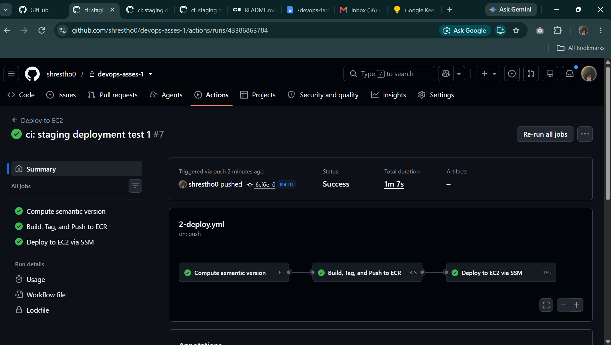
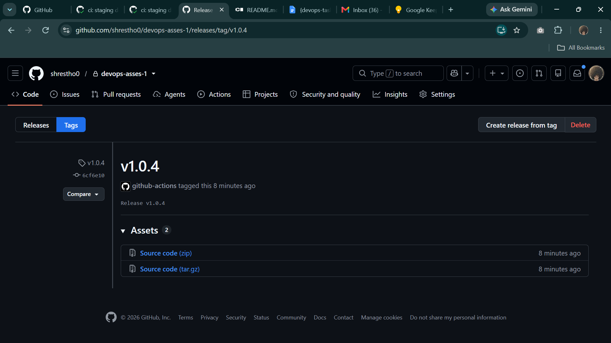
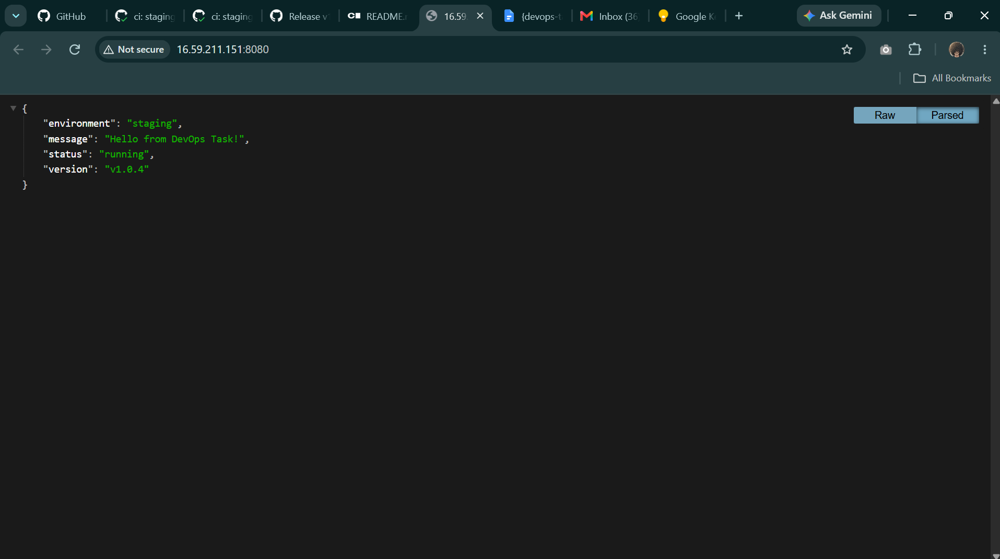
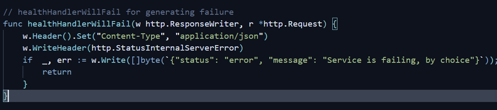
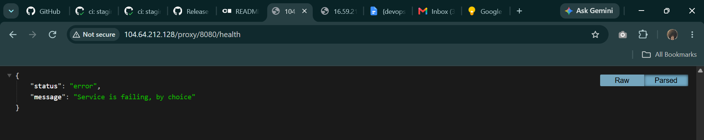
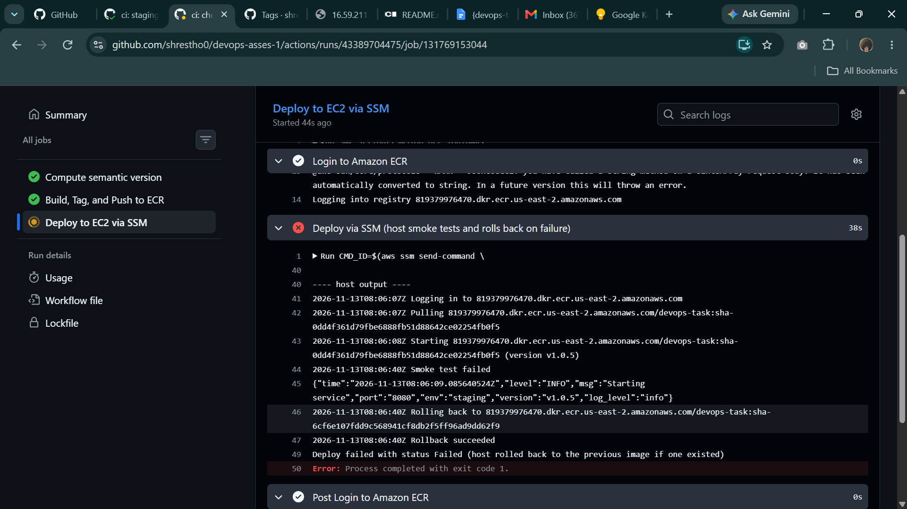

## 1. Setting up the infra

terraform init -backend-config=envs/staging.backend.hcl
terraform plan -var-file=envs/staging.tfvars
terraform apply -var-file=envs/staging.tfvars

root@localhost:~/devops-asses-1/terraform# gh variable list
NAME                 VALUE                UPDATED               
AWS_REGION           us-east-2            about 22 hours ago
EC2_INSTANCE_ID      i-09a5596eb84969362  less than a minute ago
ECR_REPOSITORY_NAME  devops-task          about 22 hours ago

root@localhost:~/devops-asses-1/terraform# gh secret list
NAME               UPDATED           
AWS_OIDC_ROLE_ARN  about 22 hours ago
root@localhost:~/devops-asses-1/terraform# 

Outputs on ../terraform/plan-staging.txt, ../terraform/apply-staging.txt

So, deployment url: http://16.59.211.151:8080

## 2. Deployment check

Create pr or push to main. 

## 3. Rollback check

If fails must rollback to older version

Generating a failure by, returning 500 from health route, temorarily. Updated the code such that it does not fail on pr checks, but, fails on health check on deployment from terraform/files/deploy-app.sh's smoke test.

So, on push/pr, it should fail. As, we are genearting failure, we'll push to main and see if
it breaks and deployment is preserved to current version v1.0.4. 

Also, v1.0.4's deployment is unaffected. 

Now, fixing it again to ensure, it rollouts successfully to v1.0.6, as, v1.0.5 artifact is failing one.  This time, with a pr. 

