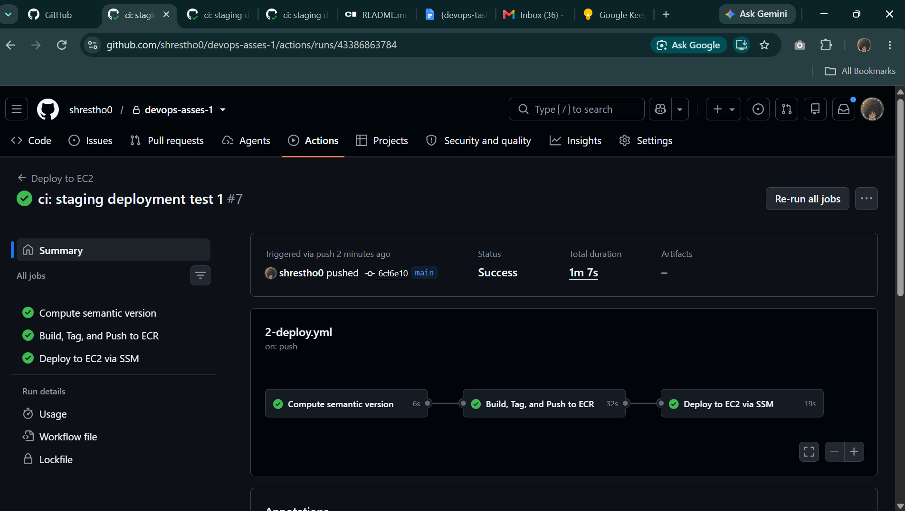
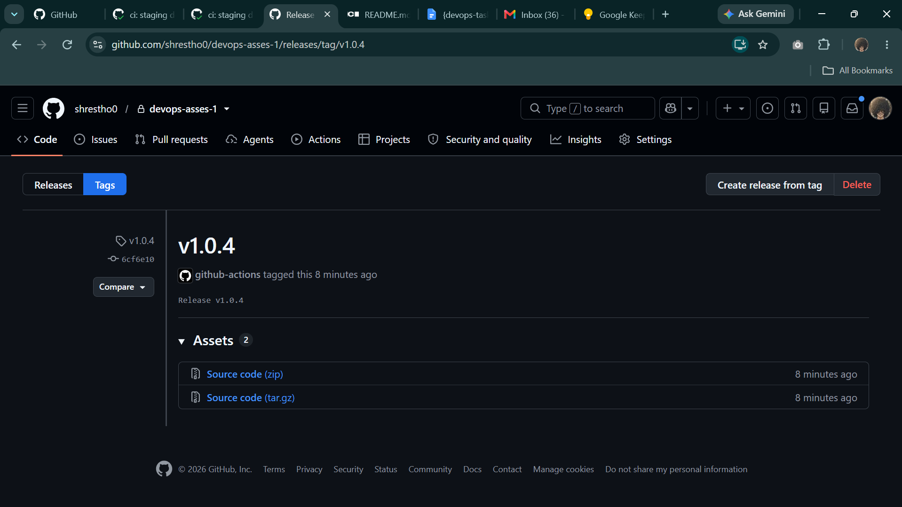
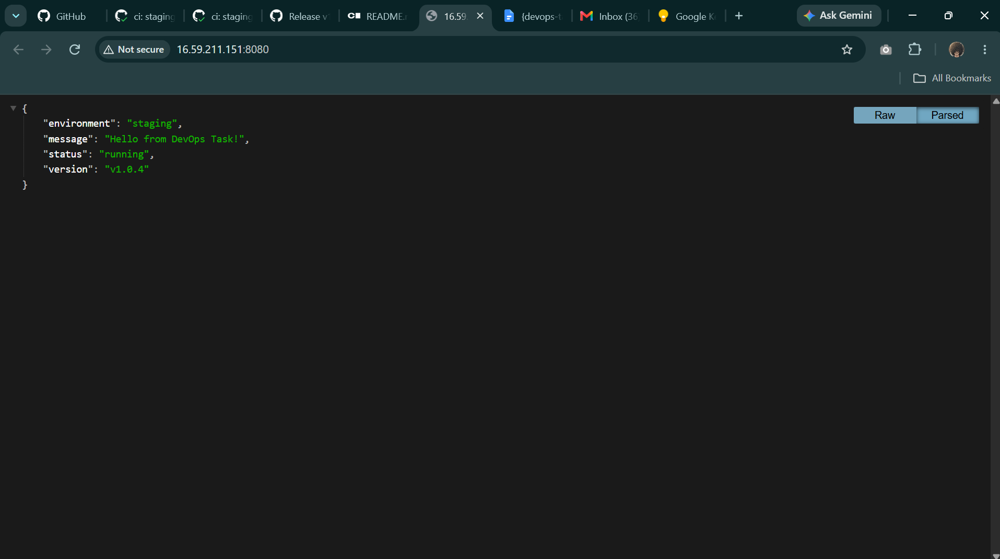
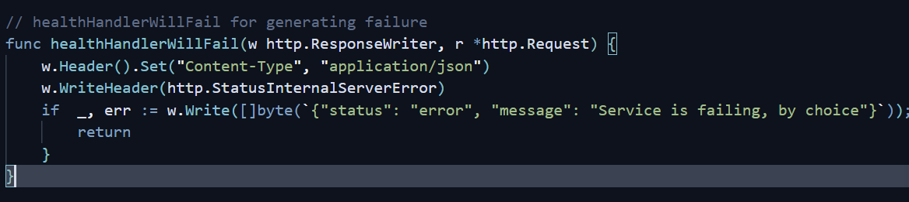
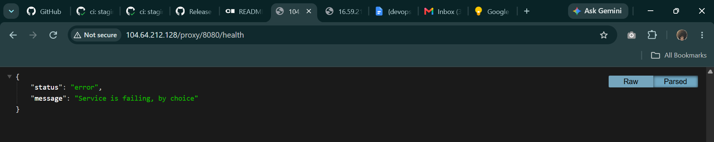
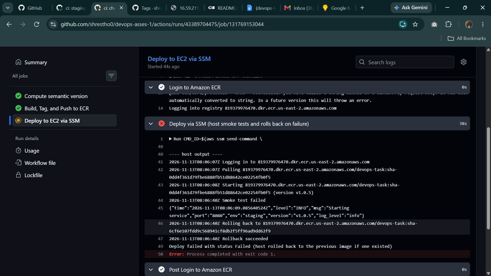
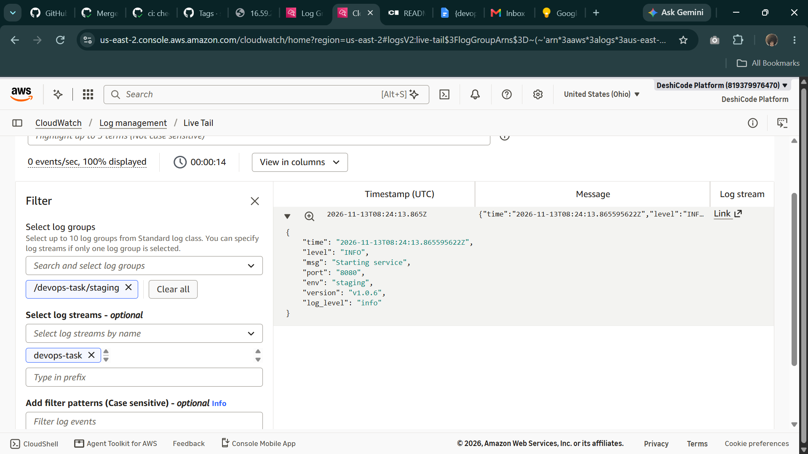
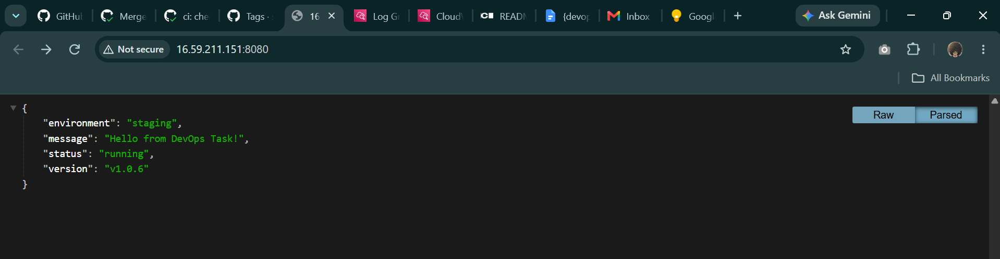

## 2-DEPLOYMENT-TERRAFORM


## Overview & Configuration

| Setting | Value |
| ----- | ----- |
| AWS Account | `819379976470` |
| AWS Region | `us-east-2` |
| GitHub OIDC Role | `GitHubActionsRole` |
| GitHub secret | `AWS_OIDC_ROLE_ARN` |
| ECR repository name | `devops-task` |
| Deployment method | AWS SSM |
| Container port | `8080` |
| Health endpoint | `/health` |
| EC2 OS | Amazon Linux 2023 |
| Terraform state | S3 with locking |

### Workflow Summary

1. Create S3 state bucket and ECR registry, and set up GitHub OIDC with an AWS IAM role and trust policy.
2. Set up the infrastructure with Terraform before deploying with GitHub CI.
3. Ensure GitHub repository variables (`AWS_REGION`, `EC2_INSTANCE_ID`, `ECR_REPOSITORY_NAME`) and secret (`AWS_OIDC_ROLE_ARN`) are configured.
4. Pushing to `main` (direct or via PR) creates a new release with semantic versioning and deploys the app with S3 state locking and the ECR registry for packages.
5. After push and deployment, check `/health` to ensure a successful deployment.

---

## 0. Setup AWS

### Verify Caller Identity & Set Default Region

```bash
root@localhost:~/devops-asses-1# aws sts get-caller-identity
```

```json
{
    "UserId": "819379976470",
    "Account": "819379976470",
    "Arn": "arn:aws:iam::819379976470:root"
}
```

```bash
aws configure set region us-east-2
```

### Create & Configure Terraform State S3 Bucket

Create bucket:

```bash
aws s3api create-bucket \
  --bucket devops-task-tfstate-819379976470 \
  --region us-east-2 \
  --create-bucket-configuration LocationConstraint=us-east-2
```

```json
{
    "Location": "[http://devops-task-tfstate-819379976470.s3.amazonaws.com/](http://devops-task-tfstate-819379976470.s3.amazonaws.com/)",
    "BucketArn": "arn:aws:s3:::devops-task-tfstate-819379976470"
}
```

Enable versioning and server-side encryption (both returned exit code `0`):

```bash
aws s3api put-bucket-versioning \
  --bucket devops-task-tfstate-819379976470 \
  --versioning-configuration Status=Enabled

aws s3api put-bucket-encryption \
  --bucket devops-task-tfstate-819379976470 \
  --server-side-encryption-configuration \
  '{"Rules":[{"ApplyServerSideEncryptionByDefault":{"SSEAlgorithm":"AES256"}}]}'
```

Block public access on the state bucket:

```bash
aws s3api put-public-access-block --bucket devops-task-tfstate-819379976470 \
  --public-access-block-configuration BlockPublicAcls=true,IgnorePublicAcls=true,BlockPublicPolicy=true,RestrictPublicBuckets=true
```

### Create ECR Repository

```bash
aws ecr create-repository \
  --repository-name devops-task \
  --image-tag-mutability IMMUTABLE \
  --image-scanning-configuration scanOnPush=true \
  --region us-east-2
```

```json
{
    "repository": {
        "repositoryArn": "arn:aws:ecr:us-east-2:819379976470:repository/devops-task",
        "registryId": "819379976470",
        "repositoryName": "devops-task",
        "repositoryUri": "[819379976470.dkr.ecr.us-east-2.amazonaws.com/devops-task](https://819379976470.dkr.ecr.us-east-2.amazonaws.com/devops-task)",
        "createdAt": "2026-11-12T09:40:18.952000+00:00",
        "imageTagMutability": "IMMUTABLE",
        "imageScanningConfiguration": {
            "scanOnPush": true
        },
        "encryptionConfiguration": {
            "encryptionType": "AES256"
        }
    }
}
```

### Configure GitHub OIDC Provider & IAM Role

- **Role ARN:** `arn:aws:iam::819379976470:role/GitHubActionsRole`

**Trust Policy:**

```json
{
  "Version": "2012-10-17",
  "Statement": [
    {
      "Effect": "Allow",
      "Principal": {
        "Federated": "arn:aws:iam::819379976470:oidc-provider/token.actions.githubusercontent.com"
      },
      "Action": "sts:AssumeRoleWithWebIdentity",
      "Condition": {
        "StringEquals": {
          "token.actions.githubusercontent.com:aud": "sts.amazonaws.com"
        },
        "StringLike": {
          "token.actions.githubusercontent.com:sub": "repo:shrestho0@84541263/devops-asses-1@1454934171:*"
        }
      }
    }
  ]
}
```

Inspect OIDC provider and update SSL thumbprints:

```bash
aws iam get-open-id-connect-provider --open-id-connect-provider-arn arn:aws:iam::819379976470:oidc-provider/token.actions.githubusercontent.com

aws iam update-open-id-connect-provider-thumbprint \
  --open-id-connect-provider-arn arn:aws:iam::819379976470:oidc-provider/token.actions.githubusercontent.com \
  --thumbprint-list 6938fd4d98bab03faadb97b34396831e3780aea1 1c58a3a8518e8759bf075b76b750d4f2df264fcd
```

---

## 1. Setting Up the Infrastructure

### Provision Infrastructure with Terraform

```bash
cd terraform
terraform init -backend-config=envs/staging.backend.hcl
terraform plan -var-file=envs/staging.tfvars | tee plan-staging.txt   # keep as evidence
terraform apply -var-file=envs/staging.tfvars
```

- **Saved outputs:** `../terraform/plan-staging.txt`, `../terraform/apply-staging.txt`
- **Deployment URL:** `http://16.59.211.151:8080`

### Configure & Verify GitHub Variables and Secrets

Set `EC2_INSTANCE_ID` from Terraform output:

```bash
gh variable set EC2_INSTANCE_ID --body "$(terraform output -raw instance_id)"
```

Verify repository variables:

```bash
root@localhost:~/devops-asses-1/terraform# gh variable list
NAME                 VALUE                UPDATED               
AWS_REGION           us-east-2            about 22 hours ago
EC2_INSTANCE_ID      i-09a5596eb84969362  less than a minute ago
ECR_REPOSITORY_NAME  devops-task          about 22 hours ago
```

Verify repository secrets:

```bash
root@localhost:~/devops-asses-1/terraform# gh secret list
NAME               UPDATED           
AWS_OIDC_ROLE_ARN  about 22 hours ago
```

### Trigger First Deployment & Verify Health

```bash
# trigger CI: builds, pushes, deploys via SSM
git commit --allow-empty -m "chore: first deploy" && git push

# after the workflow is green
curl "$(terraform output -raw app_url)/health"
```

---

## 2. Deployment Check

Create a PR or push to `main`.





---

## 3. Rollback Check

If deployment fails, it must roll back to the older version.

### Simulate Deployment Health Check Failure

A failure was generated by temporarily returning `500` from the `/health` route—updated such that it does not fail on PR checks, but fails on the deployment health check during `terraform/files/deploy-app.sh`'s smoke test.




### Push Failure to `main` & Verify Rollback

Pushing the failing change to `main` breaks the new deployment and preserves the existing deployment at `v1.0.4`, leaving `v1.0.4`'s deployment unaffected.



### Fix & Rollout to `v1.0.6` via PR

After fixing the route, a PR was opened to roll out `v1.0.6` (since the `v1.0.5` artifact was the failing one):

- **PR checks successful:** https://github.com/shrestho0/devops-asses-1/actions/runs/43391461522

Deployment logs from CloudWatch:



Deployment live:

