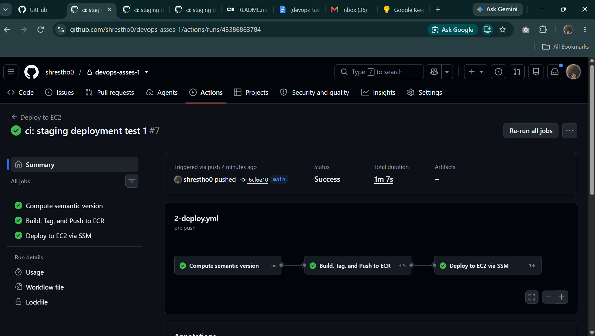
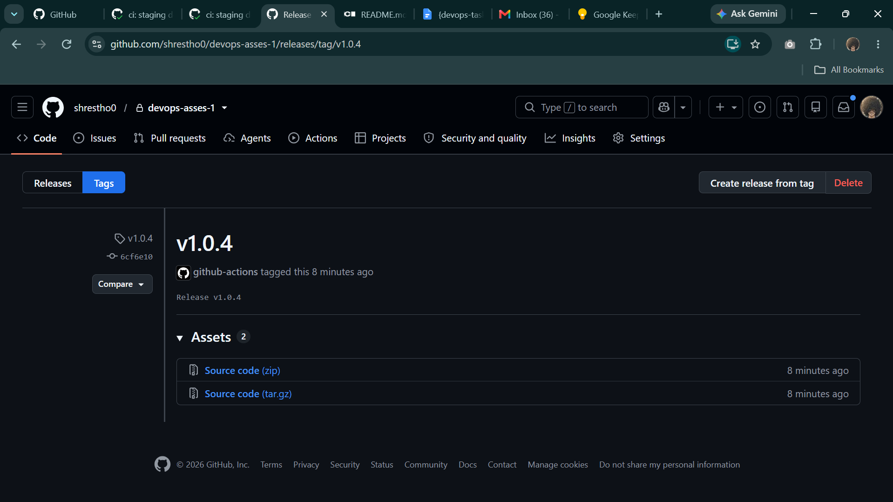
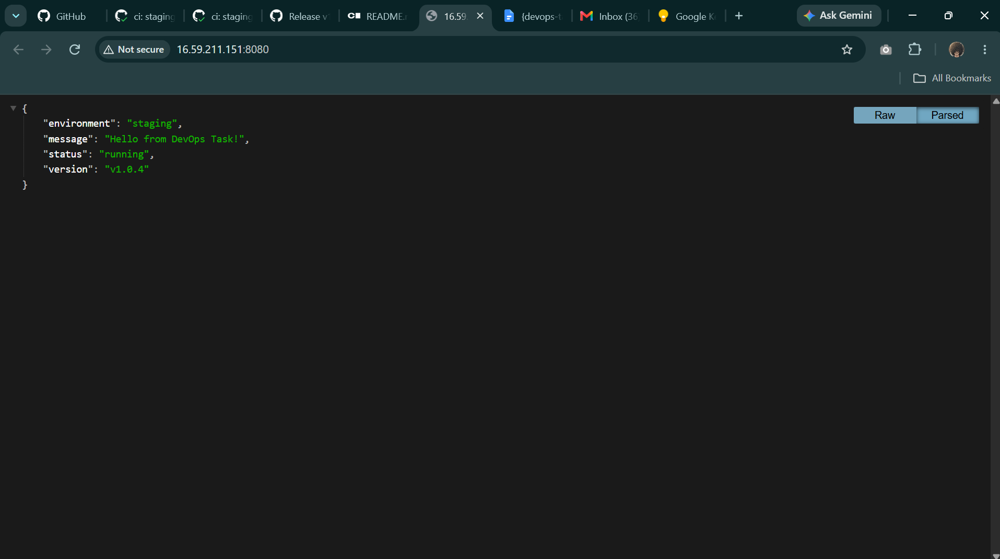
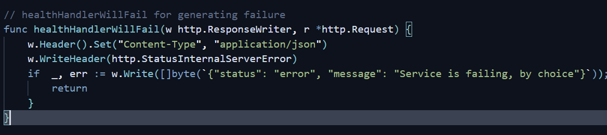
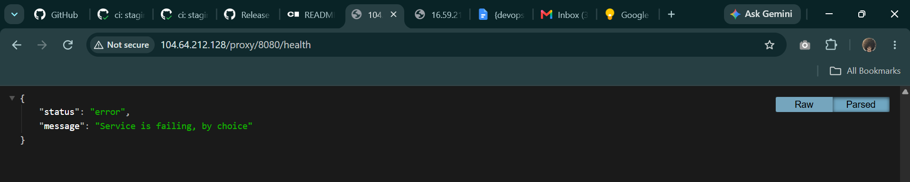
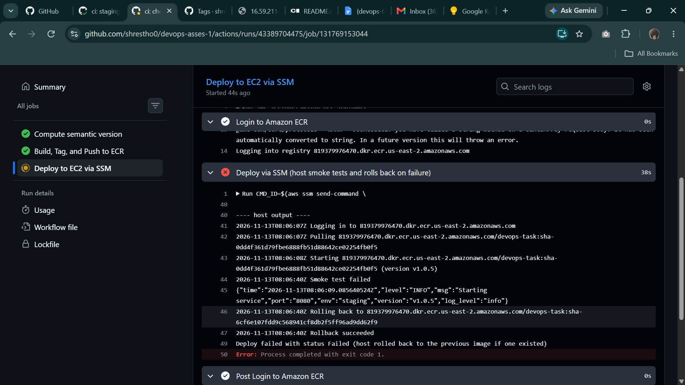
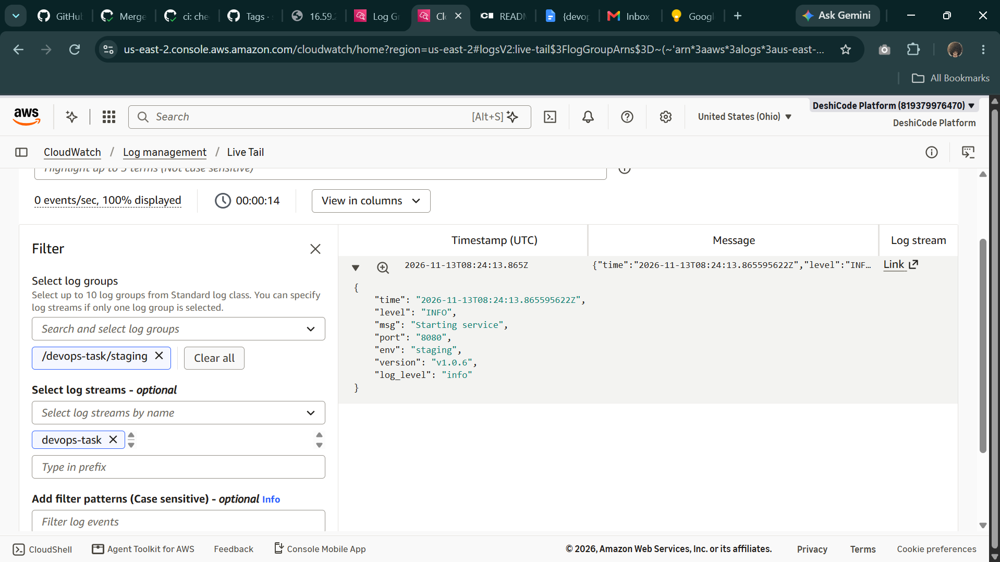
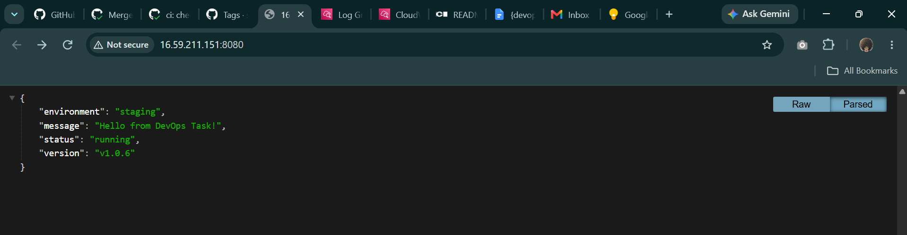

{  
	"Version": "2012-10-17",  
	"Statement": \[  
		{  
			"Effect": "Allow",  
			"Principal": {  
				"Federated": "arn:aws:iam::819379976470:oidc-provider/token.actions.githubusercontent.com"  
			},  
			"Action": "sts:AssumeRoleWithWebIdentity",  
			"Condition": {  
				"StringEquals": {  
					"token.actions.githubusercontent.com:aud": "sts.amazonaws.com"  
				},  
				"StringLike": {  
					"token.actions.githubusercontent.com:sub": "repo:shrestho0@84541263/devops-asses-1@1454934171:\*"  
				}  
			}  
		}  
	\]  
}

| Setting | Value |
| ----- | ----- |
| AWS Account | `819379976470` |
| AWS Region | `us-east-2` |
| GitHub OIDC Role | `GitHubActionsRole` |
| GitHub secret | `AWS_OIDC_ROLE_ARN` |
| ECR repository name | `devops-task` |
| Deployment method | AWS SSM |
| Container port | `8080` |
| Health endpoint | `/health` |
| EC2 OS | Amazon Linux 2023 |
| Terraform state | S3 with locking |

arn:aws:iam::819379976470:role/GitHubActionsRole

root@localhost:\~/devops-asses-1\# aws sts get-caller-identity  
{  
    "UserId": "819379976470",  
    "Account": "819379976470",  
    "Arn": "arn:aws:iam::819379976470:root"  
}

aws configure set region us-east-2

Buckets etc  
aws s3api create-bucket \\  
  \--bucket devops-task-tfstate-819379976470 \\  
  \--region us-east-2 \\  
  \--create-bucket-configuration LocationConstraint=us-east-2

{  
    "Location": "http\://devops-task-tfstate-819379976470.s3.amazonaws.com/",  
    "BucketArn": "arn:aws:s3:::devops-task-tfstate-819379976470"  
}

versioning

aws s3api put-bucket-versioning \\  
  \--bucket devops-task-tfstate-819379976470 \\  
  \--versioning-configuration Status=Enabled

aws s3api put-bucket-encryption \\  
  \--bucket devops-task-tfstate-819379976470 \\  
  \--server-side-encryption-configuration \\  
  '{"Rules":\[{"ApplyServerSideEncryptionByDefault":{"SSEAlgorithm":"AES256"}}\]}'

Both returned 0\.

Now,  
aws ecr create-repository \\  
  \--repository-name devops-task \\  
  \--image-tag-mutability IMMUTABLE \\  
  \--image-scanning-configuration scanOnPush=true \\  
  \--region us-east-2

{  
    "repository": {  
        "repositoryArn": "arn:aws:ecr:us-east-2:819379976470:repository/devops-task",  
        "registryId": "819379976470",  
        "repositoryName": "devops-task",  
        "repositoryUri": "819379976470.dkr.ecr.us-east-2.amazonaws.com/devops-task",  
        "createdAt": "2026-11-12T09:40:18.952000+00:00",  
        "imageTagMutability": "IMMUTABLE",  
        "imageScanningConfiguration": {  
            "scanOnPush": true  
        },  
        "encryptionConfiguration": {  
            "encryptionType": "AES256"  
        }  
    }  
}

—

```
aws iam get-open-id-connect-provider --open-id-connect-provider-arn arn:aws:iam::819379976470:oidc-provider/token.actions.githubusercontent.com
```

Update the ssl finger print  
aws iam update-open-id-connect-provider-thumbprint \\  
  \--open-id-connect-provider-arn arn:aws:iam::819379976470:oidc-provider/token.actions.githubusercontent.com \\  
  \--thumbprint-list 6938fd4d98bab03faadb97b34396831e3780aea1 1c58a3a8518e8759bf075b76b750d4f2df264fcd

—

**State bucket needs public access block.** :  
   aws s3api put-public-access-block \--bucket devops-task-tfstate-819379976470 \\  
     \--public-access-block-configuration BlockPublicAcls=true,IgnorePublicAcls=true,BlockPublicPolicy=true,RestrictPublicBuckets=true

—--

cd terraform  
terraform init \-backend-config=envs/staging.backend.hcl  
terraform plan  \-var-file=envs/staging.tfvars \| tee plan-staging.txt   \# keep as evidence  
terraform apply \-var-file=envs/staging.tfvars

gh variable set EC2\_INSTANCE\_ID \--body "\$(terraform output \-raw instance\_id)"

\# trigger CI: builds, pushes, deploys via SSM  
git commit \--allow-empty \-m "chore: first deploy" && git push

\# after the workflow is green  
curl "\$(terraform output \-raw app\_url)/health"  


Create buckets and ecr registry, and setup OIDC

```
aws s3api create-bucket \
  --bucket devops-task-tfstate-819379976470 \
  --region us-east-2 \
  --create-bucket-configuration LocationConstraint=us-east-2

aws s3api put-bucket-versioning \
  --bucket devops-task-tfstate-819379976470 \
  --versioning-configuration Status=Enabled

aws s3api put-bucket-encryption \
  --bucket devops-task-tfstate-819379976470 \
  --server-side-encryption-configuration \
  '{"Rules":[{"ApplyServerSideEncryptionByDefault":{"SSEAlgorithm":"AES256"}}]}'


aws ecr create-repository \
  --repository-name devops-task \
  --image-tag-mutability IMMUTABLE \
  --image-scanning-configuration scanOnPush=true \
  --region us-east-2


```

Create and set up Github OIDC with aws role and policy. 


Setup the infra before deploying with github ci. 

cd terraform/

terraform init -backend-config=envs/staging.backend.hcl
terraform plan -var-file=envs/staging.tfvars
terraform apply -var-file=envs/staging.tfvars


For github, ensure github repo secrets and variables are configued.

Repository variables
AWS_REGION
EC2_INSTANCE_ID
ECR_REPOSITORY_NAME

Repository secret      
AWS_OIDC_ROLE_ARN  

with this, pushing to main (direct or pr) will create a new release with semantic versioning and deploy the app with locking from s3 state and ecr registry for packages. 

After push and deployment, 
check health to ensure a successful deployment. 

curl "$(terraform output -raw app_url)/health"

----

# 0 setup aws
{
	"Version": "2012-10-17",
	"Statement": [
		{
			"Effect": "Allow",
			"Principal": {
				"Federated": "arn:aws:iam::819379976470:oidc-provider/token.actions.githubusercontent.com"
			},
			"Action": "sts:AssumeRoleWithWebIdentity",
			"Condition": {
				"StringEquals": {
					"token.actions.githubusercontent.com:aud": "sts.amazonaws.com"
				},
				"StringLike": {
					"token.actions.githubusercontent.com:sub": "repo:shrestho0@84541263/devops-asses-1@1454934171:*"
				}
			}
		}
	]
}


Setting
Value
AWS Account
819379976470
AWS Region
us-east-2
GitHub OIDC Role
GitHubActionsRole
GitHub secret
AWS_OIDC_ROLE_ARN
ECR repository name
devops-task
Deployment method
AWS SSM
Container port
8080
Health endpoint
/health
EC2 OS
Amazon Linux 2023
Terraform state
S3 with locking


arn:aws:iam::819379976470:role/GitHubActionsRole


root@localhost:~/devops-asses-1# aws sts get-caller-identity
{
    "UserId": "819379976470",
    "Account": "819379976470",
    "Arn": "arn:aws:iam::819379976470:root"
}


aws configure set region us-east-2


Buckets etc
aws s3api create-bucket \
  --bucket devops-task-tfstate-819379976470 \
  --region us-east-2 \
  --create-bucket-configuration LocationConstraint=us-east-2

{
    "Location": "http://devops-task-tfstate-819379976470.s3.amazonaws.com/",
    "BucketArn": "arn:aws:s3:::devops-task-tfstate-819379976470"
}


versioning

aws s3api put-bucket-versioning \
  --bucket devops-task-tfstate-819379976470 \
  --versioning-configuration Status=Enabled

aws s3api put-bucket-encryption \
  --bucket devops-task-tfstate-819379976470 \
  --server-side-encryption-configuration \
  '{"Rules":[{"ApplyServerSideEncryptionByDefault":{"SSEAlgorithm":"AES256"}}]}'

Both returned 0.


Now,
aws ecr create-repository \
  --repository-name devops-task \
  --image-tag-mutability IMMUTABLE \
  --image-scanning-configuration scanOnPush=true \
  --region us-east-2


{
    "repository": {
        "repositoryArn": "arn:aws:ecr:us-east-2:819379976470:repository/devops-task",
        "registryId": "819379976470",
        "repositoryName": "devops-task",
        "repositoryUri": "819379976470.dkr.ecr.us-east-2.amazonaws.com/devops-task",
        "createdAt": "2026-11-12T09:40:18.952000+00:00",
        "imageTagMutability": "IMMUTABLE",
        "imageScanningConfiguration": {
            "scanOnPush": true
        },
        "encryptionConfiguration": {
            "encryptionType": "AES256"
        }
    }
}


—


aws iam get-open-id-connect-provider --open-id-connect-provider-arn arn:aws:iam::819379976470:oidc-provider/token.actions.githubusercontent.com

Update the ssl finger print
aws iam update-open-id-connect-provider-thumbprint \
  --open-id-connect-provider-arn arn:aws:iam::819379976470:oidc-provider/token.actions.githubusercontent.com \
  --thumbprint-list 6938fd4d98bab03faadb97b34396831e3780aea1 1c58a3a8518e8759bf075b76b750d4f2df264fcd


—

State bucket needs public access block. :
   aws s3api put-public-access-block --bucket devops-task-tfstate-819379976470 \
     --public-access-block-configuration BlockPublicAcls=true,IgnorePublicAcls=true,BlockPublicPolicy=true,RestrictPublicBuckets=true


—--


cd terraform
terraform init -backend-config=envs/staging.backend.hcl
terraform plan  -var-file=envs/staging.tfvars | tee plan-staging.txt   # keep as evidence
terraform apply -var-file=envs/staging.tfvars

gh variable set EC2_INSTANCE_ID --body "$(terraform output -raw instance_id)"

# trigger CI: builds, pushes, deploys via SSM
git commit --allow-empty -m "chore: first deploy" && git push

# after the workflow is green
curl "$(terraform output -raw app_url)/health"


## 1. Setting up the infra

terraform init -backend-config=envs/staging.backend.hcl
terraform plan -var-file=envs/staging.tfvars
terraform apply -var-file=envs/staging.tfvars

root@localhost:~/devops-asses-1/terraform# gh variable list
NAME                 VALUE                UPDATED               
AWS_REGION           us-east-2            about 22 hours ago
EC2_INSTANCE_ID      i-09a5596eb84969362  less than a minute ago
ECR_REPOSITORY_NAME  devops-task          about 22 hours ago

root@localhost:~/devops-asses-1/terraform# gh secret list
NAME               UPDATED           
AWS_OIDC_ROLE_ARN  about 22 hours ago
root@localhost:~/devops-asses-1/terraform# 


Outputs on ../terraform/plan-staging.txt, ../terraform/apply-staging.txt

So, deployment url: http://16.59.211.151:8080


## 2. Deployment check

Create pr or push to main. 






## 3. Rollback check

If fails must rollback to older version

Generating a failure by, returning 500 from health route, temorarily. Updated the code such that it does not fail on pr checks, but, fails on health check on deployment from terraform/files/deploy-app.sh's smoke test.





So, on push/pr, it should fail. As, we are genearting failure, we'll push to main and see if
it breaks and deployment is preserved to current version v1.0.4. 



Also, v1.0.4's deployment is unaffected. 


Now, fixing it again to ensure, it rollouts successfully to v1.0.6, as, v1.0.5 artifact is failing one.  This time, with a pr. 

 PR checks successful
 https://github.com/shrestho0/devops-asses-1/actions/runs/43391461522


Deployment logs from cloudwatch


Deployment live



