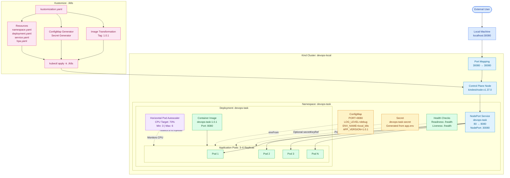

0. (Though the task asked at least 2 replicas, i mis-read/mis-understood and kept min replica to 3 and scaled upto 6. Currently, ignoring this part due to shortage of time, but, the same thing is reproducble in the very same way )

// TODO: OPS NOTE :: revisit, redo these steps to ensure we start with 2 replicas

1.  Setup ... ... ...

Control plane setup
with port binding host to container port 30080

create the cluster 
kind create cluster \
  --config k8s/1-kind-config.yml \
  --wait 120s

verify

kubectl cluster-info --context kind-devops-local
kubectl get nodes

setting up the metrics server

helm repo add metrics-server \
  https://kubernetes-sigs.github.io/metrics-server/

helm repo update

helm upgrade --install metrics-server \
  metrics-server/metrics-server \
  --version 3.14.0 \
  --namespace kube-system \
  --values k8s/helm/metrics-server-values.yml \
  --wait

Build the docker image and verify
docker build \
  -t devops-task:1.0.0 \
  -f apps/devops-task/Dockerfile \
  apps/devops-task

docker images devops-task

Load image to kind

kind load docker-image \
  devops-task:1.0.0 \
  --name devops-local

Verify if the image loaded
docker exec devops-local-control-plane \
  crictl images | grep devops-task

Initial deployment,
build manifests with kubectl kustomize k8s/
rollout deployment kubectl apply -k k8s/

2. Checking HPA, with generating load on cpu. 

kubectl exec -it -n devops-task devops-task-84cc6448b-nlh9b -- sh -c 'yes'
and
wrk -t16 -c200 -d2400s --latency http://127.0.0.1:30080/

Show normalized log/data from:
./logs/live_hpa.txt

test 1:
scaled up to 5, then 6,
at near: 2026-11-13 17:42:34, line: 57. 

and, scaled down
at near: 2026-11-13 17:52:19

test 2:
scaled up to 5, then, 6
at near: 2026-11-13 18:24:11
scaled down to 5,4,3 
2026-11-13 18:31:42

3. Rolling updates

command: 
kubectl kustomize k8s/
kubectl apply -k k8s/

Rollout at
Fri Nov 13 06:34:40 PM UTC 2026
./logs/live_traffic.txt has log at near line: 21 (2026-11-13T18:34:28.511+00:00)

4. Rollout undo at,

kubectl rollout undo deployment/devops-task \
  -n devops-task

  Fri Nov 13 06:37:28 PM UTC 2026

./logs/live_traffic.txt log shows the output at near line: 119 (2026-11-13T18:37:47.214+00:00)

## Architecture

