1. Setting up prometheus, node_exporter, cadvior first. 

Validate 
docker compose \
  -f docker-compose.yml \
  -f docker-compose.monitoring.yml \
  config --quiet

Run 
docker compose -f docker-compose.yml -f docker-compose.monitoring.yml up -d


check 1: up::Verify promtheus, node expoter, cadvisor

docker compose -f docker-compose.yml -f docker-compose.monitoring.yml exec prometheus \
  wget -qO- http://localhost:9090/api/v1/targets \
  | grep -oE '"(job|health)":"[^"]+"' | paste - -

```
"job":"app"     "job":"app"
"health":"up"   "job":"cadvisor"
"job":"cadvisor"        "health":"up"
"job":"node-exporter"   "job":"node-exporter"
"health":"up"
```


check 2: verify retention period is active

docker compose -f docker-compose.yml -f docker-compose.monitoring.yml exec prometheus \
  wget -qO- http://localhost:9090/api/v1/status/flags \
  | grep -oE '"storage.tsdb.retention[^"]*":"[^"]*"'


out:
```
"storage.tsdb.retention.size":"2GiB"
"storage.tsdb.retention.time":"15d"
```

Check if all port are running
docker ps --format "table {{.Names}}\t{{.Status}}\t{{.Ports}}"


2. added loki, alloy, now check if all fine


docker compose -f docker-compose.yml -f docker-compose.monitoring.yml config --quiet && \
docker compose -f docker-compose.yml -f docker-compose.monitoring.yml up -d


Check 1 : Verify Loki is ready and 168h (7d) retention is loaded:

docker compose -f docker-compose.yml -f docker-compose.monitoring.yml exec loki \
  wget -qO- http://localhost:3100/ready && echo ""

out: ready

docker compose -f docker-compose.yml -f docker-compose.monitoring.yml exec loki \
  wget -qO- http://localhost:3100/config | grep -E "retention_period|retention_enabled|allow_structured_metadata"

out:
  retention_enabled: true
  retention_period: 1w
  allow_structured_metadata: true
  retention_period: 0s


Check 2 — Generate a test request and verify Loki labels vs structured metadata:
```
curl -s -o /dev/null http://localhost:8080/loki-check
sleep 2

docker compose -f docker-compose.yml -f docker-compose.monitoring.yml exec loki \
  wget -qO- 'http://localhost:3100/loki/api/v1/query_range?query=%7Bservice%3D%22app%22%2Clevel%3D%22DEBUG%22%7D&limit=1' \
  | jq '.data.result[0].stream, .data.result[0].values[0]'
```


out:

```
{
  "container": "devops-task-app",
  "detected_level": "DEBUG",
  "duration": "7240",
  "level": "DEBUG",
  "method": "GET",
  "path": "/loki-check",
  "service": "app",
  "service_name": "app",
  "status": "404"
}
[
  "1794643485714853529",
  "{\"time\":\"2026-11-14T08:04:45.71469667Z\",\"level\":\"DEBUG\",\"msg\":\"HTTP Request\",\"method\":\"GET\",\"path\":\"/loki-check\",\"status\":404,\"duration\":7240}"
]
```


3. now, grafana and dashboards

added main dashboard, and other 3. 

docker compose -f docker-compose.yml -f docker-compose.monitoring.yml config --quiet && \
docker compose -f docker-compose.yml -f docker-compose.monitoring.yml up -d


4. check
source .env

curl -s http://localhost:3090/api/health && echo ""


{
  "database": "ok",
  "version": "11.5.2",
  "commit": "598e0338d5374d6bc404b02a58094132c5eeceb8"
}


curl -s -u "$GF_SECURITY_ADMIN_USER:$GF_SECURITY_ADMIN_PASSWORD" \
  http://localhost:3090/api/datasources | jq -r '.[] | "\(.name)\t\(.uid)\t\(.type)"'


Loki    loki    loki
Prometheus      prometheus      prometheus

curl -s -u "$GF_SECURITY_ADMIN_USER:$GF_SECURITY_ADMIN_PASSWORD" \
  'http://localhost:3090/api/search?type=dash-db' | jq -r '.[] | "\(.uid)\t\(.title)"'

app-dashboard   Application - DevOps Task
containers-dashboard    Containers - cAdvisor
host-dashboard  Host - Linux Metrics


---
generate some errors

for i in $(seq 1 40); do
  curl -s -o /dev/null http://localhost:8080/
  if (( i % 5 == 0 )); then
    curl -s -o /dev/null http://localhost:8080/nope-$i
  fi
  sleep 0.3
done


 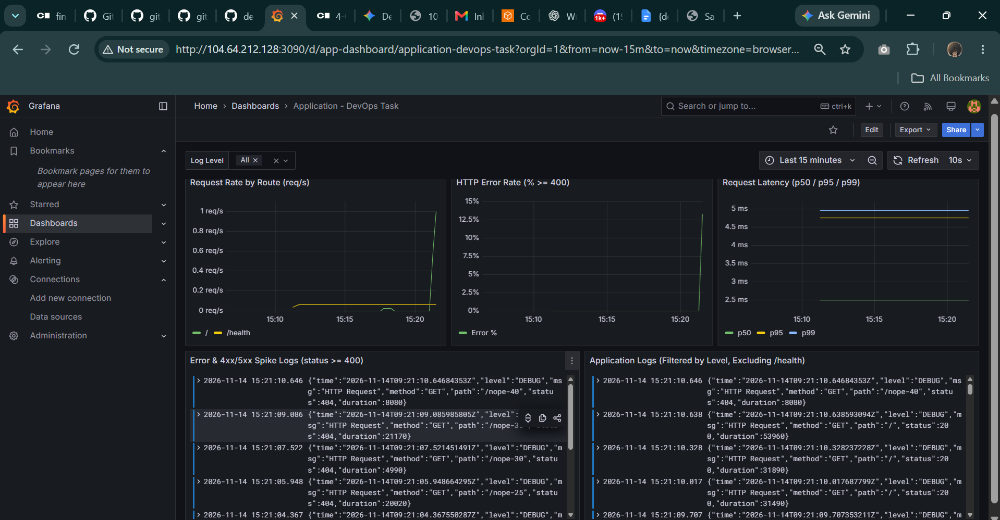


4. Alerts with prometheuss

add, apply, validate rules
docker run --rm --entrypoint promtool \
  -v "$PWD/monitoring/prometheus/rules:/rules:ro" \
  prom/prometheus:v3.2.1 check rules /rules/alerts.yml


```
Checking /rules/alerts.yml
  SUCCESS: 4 rules found
```

Recreate prometheus with rules

docker compose -f docker-compose.yml -f docker-compose.monitoring.yml config --quiet && \
docker compose -f docker-compose.yml -f docker-compose.monitoring.yml up -d

docker compose -f docker-compose.yml -f docker-compose.monitoring.yml exec prometheus \
  wget -qO- http://localhost:9090/api/v1/rules \
  | jq -r '.data.groups[].rules[] | "\(.name)\t\(.state)"'


```
AppDown inactive
HighErrorRate   inactive
HostDiskHigh    inactive
ContainerMemoryNearLimit        inactive
```


Test A: Testing alert for app down. 

docker compose -f docker-compose.yml -f docker-compose.monitoring.yml stop app
sleep 75

docker compose -f docker-compose.yml -f docker-compose.monitoring.yml exec prometheus \
  wget -qO- http://localhost:9090/api/v1/rules \
  | jq -r '.data.groups[].rules[] | select(.name=="AppDown") | "\(.name)\t\(.state)"'
# Expected: AppDown	firing

Result:
```
root@localhost:~/devops-asses-1# docker compose -f docker-compose.yml -f docker-compose.monitoring.yml exec prometheus   wget -qO- http://localhost:9090/api/v1/rules   | jq -r '.data.groups[].rules[] | select(.name=="AppDown") | "\(.name)\t\(.state)"'
AppDown pending
root@localhost:~/devops-asses-1# docker compose -f docker-compose.yml -f docker-compose.monitoring.yml exec prometheus   wget -qO- http://localhost:9090/api/v1/rules   | jq -r '.data.groups[].rules[] | select(.name=="AppDown") | "\(.name)\t\(.state)"'
AppDown firing
```

# Restore app and confirm recovery:
docker compose -f docker-compose.yml -f docker-compose.monitoring.yml start app


Test B

sed -i 's/status=~"5.."/status=~"4..|5.."/' monitoring/prometheus/rules/alerts.yml
docker compose -f docker-compose.yml -f docker-compose.monitoring.yml exec prometheus \
  wget -q --post-data="" -O- http://localhost:9090/-/reload

# Generate >5% 404 error rate above 0.1 req/s for ~5m15s:
for i in $(seq 1 320); do
  curl -s -o /dev/null http://localhost:8080/
  curl -s -o /dev/null http://localhost:8080/nope
  sleep 1
done

docker compose -f docker-compose.yml -f docker-compose.monitoring.yml exec prometheus \
  wget -qO- http://localhost:9090/api/v1/rules \
  | jq -r '.data.groups[].rules[] | select(.name=="HighErrorRate") | "\(.name)\t\(.state)"'
# Expected: HighErrorRate	firing

result

```
root@localhost:~/devops-asses-1# docker compose -f docker-compose.yml -f docker-compose.monitoring.yml exec prometheus   wget -qO- http://localhost:9090/api/v1/rules   | jq -r '.data.groups[].rules[] | select(.name=="HighErrorRate") | "\(.name)\t\(.state)"'
HighErrorRate   pending

root@localhost:~/devops-asses-1# docker compose -f docker-compose.yml -f docker-compose.monitoring.yml exec prometheus   wget -qO- http://localhost:9090/api/v1/rules   | jq -r '.data.groups[].rules[] | select(.name=="HighErrorRate") | "\(.name)\t\(.state)"'
HighErrorRate   firing

```
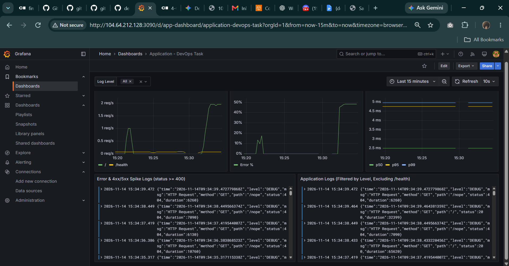

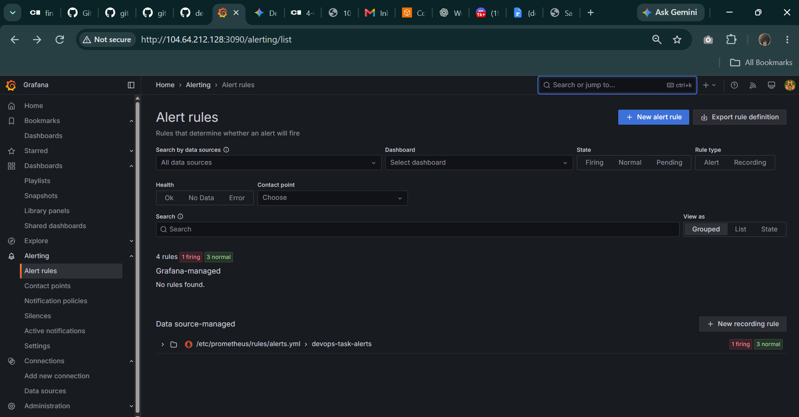

# Revert back to 5xx-only and reload:
sed -i 's/status=~"4..|5.."/status=~"5.."/' monitoring/prometheus/rules/alerts.yml
docker compose -f docker-compose.yml -f docker-compose.monitoring.yml exec prometheus \
  wget -q --post-data="" -O- http://localhost:9090/-/reload


test c
# 1. Lower HostDiskHigh threshold from > 0.80 to > 0.01 and reload Prometheus
sed -i 's/> 0.80/> 0.01/' monitoring/prometheus/rules/alerts.yml
docker compose -f docker-compose.yml -f docker-compose.monitoring.yml exec prometheus \
  wget -q --post-data="" -O- http://localhost:9090/-/reload

# 2. Verify it enters "pending" immediately
docker compose -f docker-compose.yml -f docker-compose.monitoring.yml exec prometheus \
  wget -qO- http://localhost:9090/api/v1/rules \
  | jq -r '.data.groups[].rules[] | select(.name=="HostDiskHigh") | "\(.name)\t\(.state)"'
# Expected: HostDiskHigh	pending


4.x

adding alert manager
docker run --rm --entrypoint /bin/sh \
  -v "$PWD/monitoring/alertmanager/alertmanager.yml:/etc/alertmanager/alertmanager.yml:ro" \
  prom/alertmanager:v0.28.1 \
  -c "touch /tmp/discord_webhook_url && amtool check-config /etc/alertmanager/alertmanager.yml"

docker compose -f docker-compose.yml -f docker-compose.monitoring.yml config --quiet && echo "Compose valid"

docker compose -f docker-compose.yml -f docker-compose.monitoring.yml up -d
docker compose -f docker-compose.yml -f docker-compose.monitoring.yml exec prometheus \
  wget -q --post-data="" -O- http://localhost:9090/-/reload

docker compose -f docker-compose.yml -f docker-compose.monitoring.yml exec prometheus \
  wget -qO- http://localhost:9090/api/v1/alertmanagers | jq '.data.activeAlertmanagers'

```
[
  {
    "url": "http://alertmanager:9093/api/v2/alerts"
  }
]
```


test alert on discord
docker compose -f docker-compose.yml -f docker-compose.monitoring.yml exec alertmanager \
  wget -qO- --header="Content-Type: application/json" \
  --post-data='[{"labels":{"alertname":"DiscordWebhookTest","severity":"warning"},"annotations":{"summary":"Alertmanager Discord integration test","description":"Sent from devops-task-alertmanager."}}]' \
  http://localhost:9093/api/v2/alerts

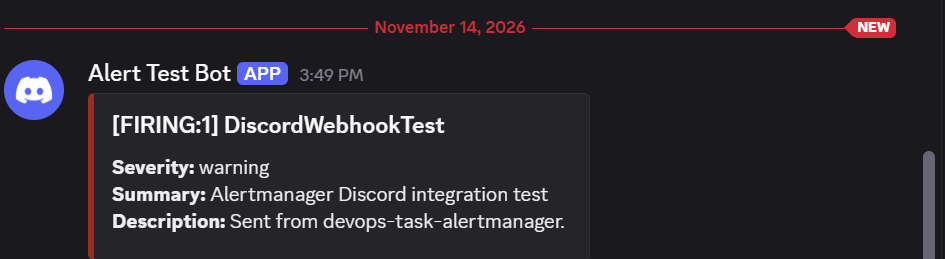


Now, simulating and receing alerts on discord


# 1. Allocate ~118MiB in devops-task-app for 400s
docker exec -d devops-task-app sh -c \
  'awk "BEGIN { for(i=0;i<620000;i++) a[i]=\"0123456789012345678901234567890123456789012345678901234567890123456789012345678901234567890123456789\"; system(\"sleep 400\") }"'

# 2. Verify memory sits between 90% and 99% (e.g., ~118MiB / 128MiB)
sleep 3
docker stats --no-stream devops-task-app

```
CONTAINER ID   NAME              CPU %     MEM USAGE / LIMIT   MEM %     NET I/O         BLOCK I/O    PIDS
11ce532fe884   devops-task-app   0.00%     116.6MiB / 128MiB   91.12%    357kB / 517kB   221kB / 0B   10
```


Wait for 5m + 15 sec for alert to firing. 

# Confirm state = "firing"
docker compose -f docker-compose.yml -f docker-compose.monitoring.yml exec prometheus \
  wget -qO- http://localhost:9090/api/v1/rules \
  | jq -r '.data.groups[].rules[] | select(.name=="ContainerMemoryNearLimit") | "\(.name)\t\(.state)"'
# Expected: ContainerMemoryNearLimit	firing

# 4. Clean up memory load and confirm recovery
docker compose -f docker-compose.yml -f docker-compose.monitoring.yml restart app

 
 
# 1. Lower HostDiskHigh threshold from > 0.80 to > 0.01 and reload Prometheus
sed -i 's/> 0.80/> 0.01/' monitoring/prometheus/rules/alerts.yml
docker compose -f docker-compose.yml -f docker-compose.monitoring.yml exec prometheus \
  wget -q --post-data="" -O- http://localhost:9090/-/reload

# 2. Verify it enters "pending" immediately
docker compose -f docker-compose.yml -f docker-compose.monitoring.yml exec prometheus \
  wget -qO- http://localhost:9090/api/v1/rules \
  | jq -r '.data.groups[].rules[] | select(.name=="HostDiskHigh") | "\(.name)\t\(.state)"'
# Expected: HostDiskHigh	pending


HighMemory and High Disk alerts are in pending state

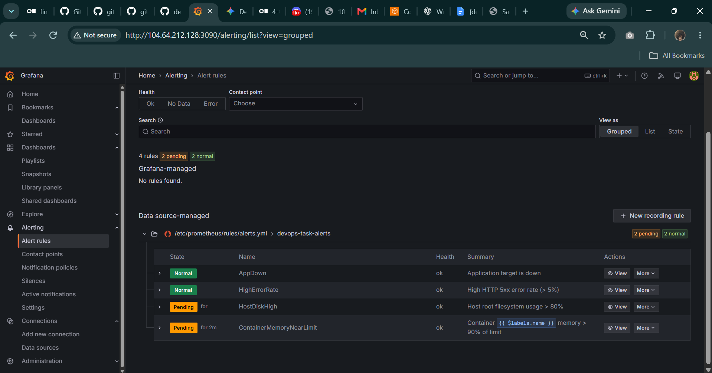

Alert high memory firing + discord notifcation

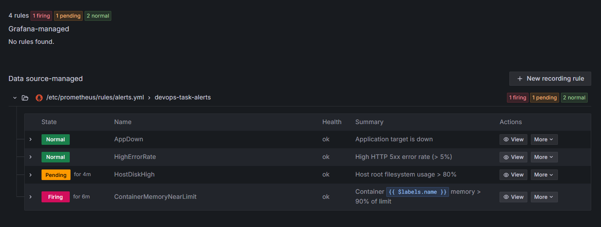
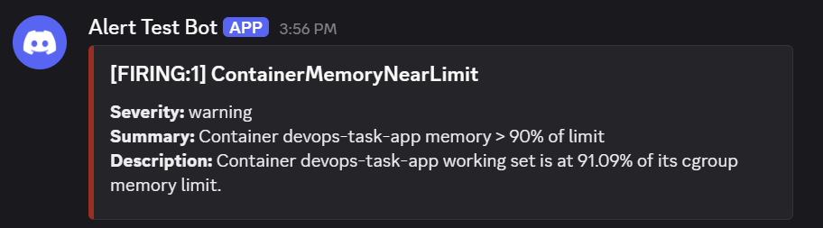
memory cleanup and recovery
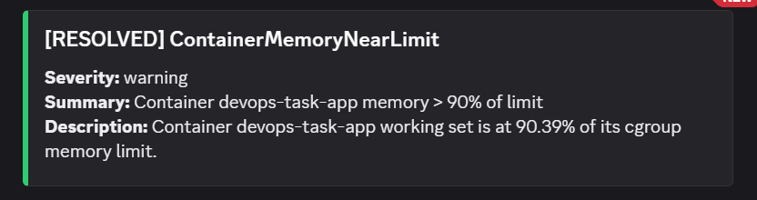


Now, alert for high disk,
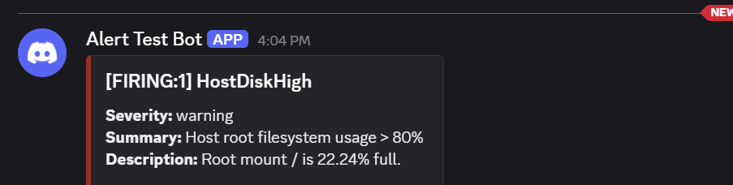

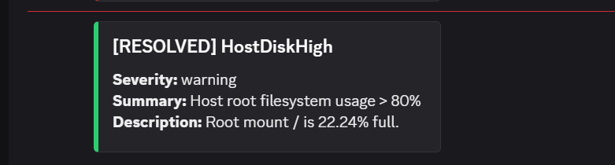


Final test:

docker compose -f docker-compose.yml -f docker-compose.monitoring.yml stop app
# Wait ~90s (1m rule `for` + 15s group_wait) -> verify [FIRING:1] AppDown arrives in Discord.

docker compose -f docker-compose.yml -f docker-compose.monitoring.yml start app
# Wait ~30s -> verify [RESOLVED] AppDown arrives in Discord.

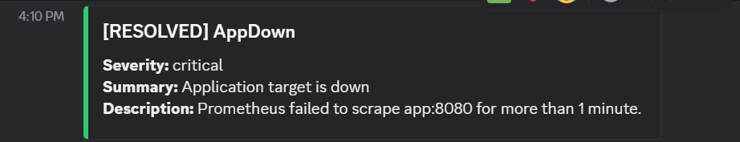
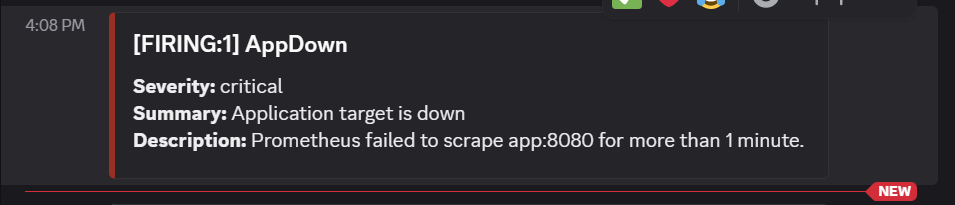


---


documentation drafts:
**Startup & Access**

* **Command:** `docker compose -f docker-compose.yml -f docker-compose.monitoring.yml up -d`
* **Env file:** Copy `.env.example` to `.env` (gitignored). Required vars: `GF_SECURITY_ADMIN_USER`, `GF_SECURITY_ADMIN_PASSWORD`, `DISCORD_WEBHOOK_URL`.
* **Published ports:** Only `8080` (`app`) and `3090` (`grafana` -> `http://localhost:3090`). Internal-only: Prometheus (`9090`), Alertmanager (`9093`), Loki (`3100`), Alloy (`12345`), Node Exporter (`9100`), cAdvisor (`8080`).
* **Provisioning:** Datasources (`prometheus`, `loki` UIDs) and 3 dashboards (`Application - DevOps Task`, `Host - Linux Metrics`, `Containers - cAdvisor`) auto-load from `monitoring/grafana/provisioning/`.

**Mounts, Devices & Privileges**

| Service | Host Mount / Device | Mode | Reason & Security Note |
| --- | --- | --- | --- |
| `node-exporter` | `/` -> `/host` | `ro,rslave` | Reads host `/proc`, `/sys`, and `/` disk metrics (`--path.rootfs=/host`) without `pid: host` or `privileged: true`. |
| `cadvisor` | `/`, `/var/run`, `/sys`, `/var/lib/docker`, `/dev/disk` | `ro` | Collects Docker container cgroup stats (`--docker_only=true`). |
| `cadvisor` | `/dev/kmsg` + `privileged: true` | device + privileged | Required on cgroup v2 Linux hosts for full container CPU, memory limit, and OOM telemetry. |
| `alloy` | `/var/run/docker.sock` | `ro` | Discovers containers and tails stdout/stderr logs. Read-only `docker.sock` still grants effective root-equivalent visibility over the Docker daemon. |

**Loki Cardinality, Log Gotchas & Retention**

* **Indexed labels (`service`, `container`, `level`):** Strictly bounded.
* **Rejected labels (`path`, `status`, `method`, `duration`):** Stored as **structured metadata** instead. The Go `/` handler returns `404` for any unmatched URL, making `path` unbounded; indexing it would cause stream cardinality explosion.
* **Code-specific log behavior:**
* Go `log/slog` outputs uppercase levels (`DEBUG`, `INFO`, `WARN`, `ERROR`).
* HTTP `4xx`/`5xx` requests are logged at `DEBUG` (not `ERROR`), so error queries filter on `| json | status >= 400`.
* Docker healthchecks hit `/health` every `15s`; excluded in dashboards via `| path != "/health"`.
* `duration` is logged in nanoseconds.


* **Retention:** Prometheus = `15d` (capped at `2GB`); Loki = `7d` (`168h`, enforced by compactor with `delete_request_store: filesystem`).

**Alert Rules & Routing**

* Prometheus evaluates `monitoring/prometheus/rules/alerts.yml` every `15s` and sends alerts to Alertmanager (`alertmanager:9093`), which forwards firing and `[RESOLVED]` notifications to Discord via `webhook_url_file` (written from `DISCORD_WEBHOOK_URL` at container start).

| Alert | Expression | `for` | Severity | Rationale |
| --- | --- | --- | --- | --- |
| `AppDown` | `up{job="app"} == 0` | `1m` | `critical` | 4 missed `15s` scrapes; rides out brief container restarts. |
| `HighErrorRate` | `5xx` ratio `> 5%` AND rate `> 0.1 req/s` | `5m` | `critical` | Catches sustained `5xx` server failures without false-firing on bot `404` scans or low traffic. |
| `HostDiskHigh` | Root `/` usage `> 80%` | `10m` | `warning` | Disks fill slowly; avoids transient write blips. |
| `ContainerMemoryNearLimit` | Working set `> 90%` of limit (`limit > 0`) | `5m` | `warning` | Warns before OOM kill (e.g., `app` capped at `128M`), ignoring brief spikes. |

**Incident Walkthrough (Error Spike -> Root Cause)**

1. **Application dashboard:** Identify the spike timestamp in **HTTP Error Rate (% >= 400)**, check affected route in **Request Rate by Route**, and check **p50/p95/p99 latency**.
2. **Logs panel:** Filter `{service="app"} | json | path != "/health" | status >= 400` in that window; inspect `status`, `path`, `method`, `duration`, and `msg` (`404` scan vs `500` server error).
3. **Containers dashboard:** Check `devops-task-app` **Memory vs Limit (%)** (`128M` cap), **CPU Usage** (`0.50` cap), and **Restarts (15m window)** for OOM kills or throttling.
4. **Host dashboard:** Check host CPU, memory, `/` disk, and network throughput for node-level saturation.
5. **Resolution:** Confirm alert state in Grafana / Discord, apply fix, and verify error rate drops to `0%` and Alertmanager sends `[RESOLVED]`.
