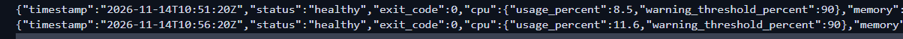

# System Health Monitoring

## Project Files

| File | Purpose |
| --- | --- |
| `system_health.sh` | Main production-oriented Bash script |
| `system-health.service` | Systemd oneshot service |
| `system-health.timer` | Executes every 5 minutes |

---

## Implemented Features

- CPU usage measured over a 1-second sampling interval.
- Memory usage based on `MemAvailable`.
- Disk usage across all filesystems reported by `df`.
- 1, 5 and 15-minute load averages.
- Top 5 processes sorted by memory consumption.
- Timestamped JSON Lines logging.
- `--json` for machine-readable stdout.
- Configurable `--cpu`, `--mem`, and `--disk` thresholds.
- Automatic log rotation: 5 MiB maximum active log, up to 5 backups.
- `--help` and meaningful exit codes.

---

## Usage & CLI Options

```bash
cd scripts/system_health_check/
./system_health.sh
```

### Options

| Option | Description |
| --- | --- |
| `--cpu PERCENT` | CPU warning threshold (default: `90`) |
| `--mem PERCENT` | Memory warning threshold (default: `85`) |
| `--disk PERCENT` | Per-filesystem disk warning threshold (default: `80`) |
| `--log-file PATH` | Log file path (default: `health_log.txt` beside the script) |
| `--json` | Print the report as JSON to stdout |
| `--help` | Show this help |

---

## Exit Code Interpretation

| Code | Meaning | CLI Description |
| --- | --- | --- |
| `0` | Healthy | All metrics are within thresholds |
| `1` | One or more thresholds exceeded | One or more warning thresholds were exceeded |
| `2` | Critical execution, collection, configuration or logging failure | A collection, configuration, or logging error occurred |

**Important:** The assessment specifies warning thresholds but does not define separate critical thresholds. Therefore, code `2` is reserved for execution and collection failures rather than inventing additional metric thresholds.

---

## Metrics Collection & Design Details

### 1. CPU Usage

Linux provides CPU counters through `/proc/stat`. It contains cumulative CPU time spent in different states, including:

- `user`: Time executing user-space processes.
- `nice`: Time executing niced processes.
- `system`: Time executing kernel code.
- `idle`: Idle CPU time.
- `iowait`: Time waiting for I/O.
- `irq` / `softirq`: Interrupt handling.
- `steal`: Time taken by the hypervisor for other virtual machines.

**Calculation:**

$$CPU\ Usage = \frac{\Delta Total-\Delta Idle}{\Delta Total}\times100$$

- Treat idle time as `idle + iowait`.
- The total should include the first eight CPU fields, without adding `guest` and `guest_nice` again.

---

### 2. Memory Usage

Linux provides memory counters through `/proc/meminfo`.

**Important fields:**

| Field | Meaning |
| --- | --- |
| `MemTotal` | Total physical memory |
| `MemFree` | Completely unused memory |
| `MemAvailable` | Estimated memory available without swapping |
| `Buffers` | Kernel buffer memory |
| `Cached` | Filesystem cache |

- **Monitoring guidance:** For monitoring, use `MemAvailable`, not just `MemFree`.
- **Why?** Linux intentionally uses otherwise-unused RAM for filesystem caching. That memory can be reclaimed when applications need it.

**Calculation:**

$$Memory\ Usage = \frac{MemTotal-MemAvailable}{MemTotal}\times100$$

- Your output should ideally include both the percentage and absolute usage.

---

### 3. Disk Usage — All Mounted Filesystems

- **Linux utility:** `df` — reports filesystem disk space usage.

**Fields to collect:**

- Filesystem name
- Total size
- Used space
- Available space
- Usage percentage
- Mount point

**Important considerations & design decisions:**

- Use the portable output format (`-P`) to avoid filesystem entries wrapping across multiple lines.
- Normal `df` output generally excludes certain pseudo-filesystems, whereas `df -a` includes them.
- Since the assignment explicitly says all mounted filesystems, decide whether pseudo-filesystems such as `/proc`, `/sys`, and `/dev` should also appear:
  - **Strict interpretation:** Include them.
  - **Practical capacity monitoring:** Filtering non-storage pseudo-filesystems is usually more useful.

---

### 4. Load Average

Linux exposes three load averages in `/proc/loadavg`:

| Value | Measurement |
| --- | --- |
| First | 1-minute average |
| Second | 5-minute average |
| Third | 15-minute average |

**Example:**

```text
0.42 0.38 0.31
```

- These values represent average runnable and uninterruptible tasks, not CPU utilization percentages.
- **Operational distinction:** A load average of `4` means different things on a 4-core machine and a 32-core machine.
- You can also collect the number of CPU cores to provide context, although the assignment doesn't explicitly require it.

---

### 5. Top 5 Processes by Memory Usage

- **Linux utility:** `ps`

**Fields to retrieve:**

| Field | Purpose |
| --- | --- |
| `PID` | Process ID |
| `COMMAND` | Process name |
| `%MEM` | Percentage of physical memory |
| `RSS` | Resident memory in KB |

**Implementation logic:**

1. Retrieve all processes.
2. Sort by memory percentage in descending order.
3. Select the first five processes.
4. Preserve the column headers in the output.

- **Security note:** Use the process name rather than full command-line arguments unless you specifically need them. Command-line arguments can contain sensitive information.

---

## Installation

```bash
sudo install -m 0755 system_health.sh /usr/local/sbin/system_health.sh

sudo install -m 0644 system-health.service \
  /etc/systemd/system/

sudo install -m 0644 system-health.timer \
  /etc/systemd/system/

sudo systemctl daemon-reload
sudo systemctl enable --now system-health.timer
```

**Verify scheduling:**

```bash
systemctl list-timers system-health.timer
```

**Inspect execution logs:**

```bash
journalctl -u system-health.service
```

---

## Validation & Verification

```text
root@localhost:~/devops-asses-1/scripts/system_health_check# shellcheck system_health.sh
root@localhost:~/devops-asses-1/scripts/system_health_check# echo $?
0
```



---

## Uninstall Commands

Run the following commands to completely remove the System Health Monitoring script and its systemd scheduling configuration.

1. **Stop and disable the timer**

```bash
sudo systemctl stop system-health.timer
sudo systemctl disable system-health.timer
```

2. **Stop the service (if running)**

```bash
sudo systemctl stop system-health.service
```

3. **Remove the systemd files**

```bash
sudo rm -f /etc/systemd/system/system-health.service
sudo rm -f /etc/systemd/system/system-health.timer
```

4. **Remove the Bash monitoring script**

```bash
sudo rm -f /usr/local/sbin/system_health.sh
```

5. **Reload systemd**

```bash
sudo systemctl daemon-reload
sudo systemctl reset-failed
```

6. **Verify removal**

```bash
systemctl status system-health.timer
systemctl status system-health.service
```

Both should report that the units could not be found.

### Optional: Remove Monitoring Logs

If your script stores logs in `/var/log/system-health/`, remove them with:

```bash
sudo rm -rf /var/log/system-health/
```

Only run this if you no longer need the historical monitoring data.

### Complete Uninstall (All Commands Together)

```bash
sudo systemctl stop system-health.timer
sudo systemctl disable system-health.timer
sudo systemctl stop system-health.service

sudo rm -f /etc/systemd/system/system-health.service
sudo rm -f /etc/systemd/system/system-health.timer
sudo rm -f /usr/local/sbin/system_health.sh

sudo systemctl daemon-reload
sudo systemctl reset-failed
```

**Uninstallation complete:** The systemd timer, service configuration, and monitoring script will be removed. Historical logs are preserved unless you explicitly delete them.